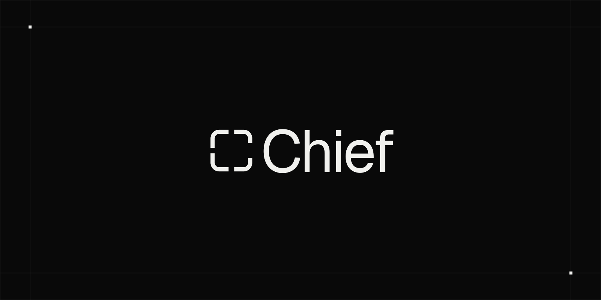

<p align="center">
  <a href="https://heychief.sh">
    
  </a>
</p>

# Chief

Chief is a local-first workspace where people and proactive AI agents work together across channels, threads, files, schedules, tools, and action items.

Chief is in early preview, with desktop apps for macOS and Windows.

## What Chief does

- Coordinates a team of specialist agents across business, research, marketing, analytics, product engineering, and integration setup.
- Keeps delegated work in shared channels and threads, with detailed activity available when you want to inspect it.
- Turns reusable playbooks into work that can run now or on a schedule.
- Executes scheduled work in private sessions while keeping conversations focused on decisions and useful outcomes.
- Produces reviewable results with structured artifacts such as charts, tables, drafts, and action items.
- Connects agents to approved tools while keeping publishing, outreach, and spend behind explicit approval rules.
- Runs the agent runtime locally and packages it with the desktop app.

## The team

| Agent          | Responsibility                                                                     |
| -------------- | ---------------------------------------------------------------------------------- |
| Chief          | Coordinates the workspace, delegates work, and brings decisions back to you.       |
| Engineer       | Investigates product issues and prepares reviewable implementation changes.        |
| Setup          | Connects services and resolves missing prerequisites.                              |
| Marketer       | Grounds positioning, audience, voice, vocabulary, and claims in evidence.          |
| Content Writer | Creates channel-native drafts grounded in brand context and evidence.              |
| Analyst        | Reviews acquisition, product, funnel, and content performance.                     |
| Prospector     | Finds timely prospects, conversations, buying signals, and research opportunities. |
| Ads Manager    | Reviews paid acquisition and proposes changes for approval.                        |

Agents can use focused playbooks, connected services, and general workspace tools to research, create artifacts, implement changes, and run recurring work. Tool access and consequential actions remain governed by workspace permissions and approval rules.

## Repository structure

| Path                                                           | Purpose                                                               |
| -------------------------------------------------------------- | --------------------------------------------------------------------- |
| [`apps/desktop`](./apps/desktop/README.md)                     | Tauri desktop app and React interface.                                |
| [`apps/web`](./apps/web/README.md)                             | Marketing site, authentication, and desktop auth bridge.              |
| [`packages/agent-runtime`](./packages/agent-runtime/README.md) | Local Node runtime, scheduling, tools, channels, and agent execution. |
| [`packages/email`](./packages/email/README.md)                 | React Email templates and Cloudflare Email Service transport.         |
| [`packages/ui`](./packages/ui/README.md)                       | Shared components, typography, and design tokens.                     |

## Local development

### Prerequisites

- macOS 13 or newer, or Windows 10 or newer, for the desktop app
- Node.js 24 or newer
- pnpm 10.17 or newer
- Rust and the platform dependencies required by Tauri

### Install

Clients default to Chief's hosted relay and sign-in service. To use local or
self-hosted services, configure the URL overrides described in the
[contributing guide](./CONTRIBUTING.md#run-chief-locally) or select your relay
in the app. Starting a local relay alone does not redirect client traffic.

```bash
git clone https://github.com/danielsims/chief.git
cd chief
pnpm install
```

Start Docker Desktop, then run:

```bash
pnpm dev
```

This starts the existing self-hosted Docker stack at `http://localhost:8080`,
applies local database migrations and opens the normal Tauri desktop dev app
with hot reload. Existing Docker images are reused with the current relay source
mounted into them; rebuild images with `pnpm self-host:up` when dependencies change. It preserves local accounts and workspaces. Production is not
deployed or changed. If the app previously selected another relay, use
**Connect a self-hosted relay** and enter `http://localhost:8080`.

`pnpm desktop:dev` is an alias for the same loop. Ctrl+C stops the desktop;
`pnpm self-host:down` stops Docker services without deleting their data.
The authentication UI is served by the Docker stack. The React Email preview
remains available separately with `pnpm email`.

## Useful commands

```bash
pnpm typecheck
pnpm build
pnpm --filter @chief/desktop build:app
```

## Release security

The repository contains sanitized development examples only. Official signing certificates, notarization credentials, updater keys, and release configuration are supplied by a private build environment and are never committed. Forks must provide and use their own release identity.

## Contributing

Bug reports, focused fixes, and thoughtful product discussions are welcome. Read
the [contributing guide](./CONTRIBUTING.md) before opening a pull request and
follow the [Code of Conduct](./CODE_OF_CONDUCT.md) in project spaces. Report
security vulnerabilities through the process in [SECURITY.md](./SECURITY.md).

## License

Chief's source code is available under the [GNU Affero General Public License
version 3](./LICENSE). You may run, study, modify, and self-host it under the
terms of that license. Paid Chief plans cover the managed product and hosted
services, not a separate license to the source code.

If you distribute a modified version, or make one available to users over a
network, you must make its corresponding source available under the same
license.

Copyright © 2026 Latent Supply Pty Ltd.

## Website

Learn more and download Chief at [heychief.sh](https://heychief.sh).
